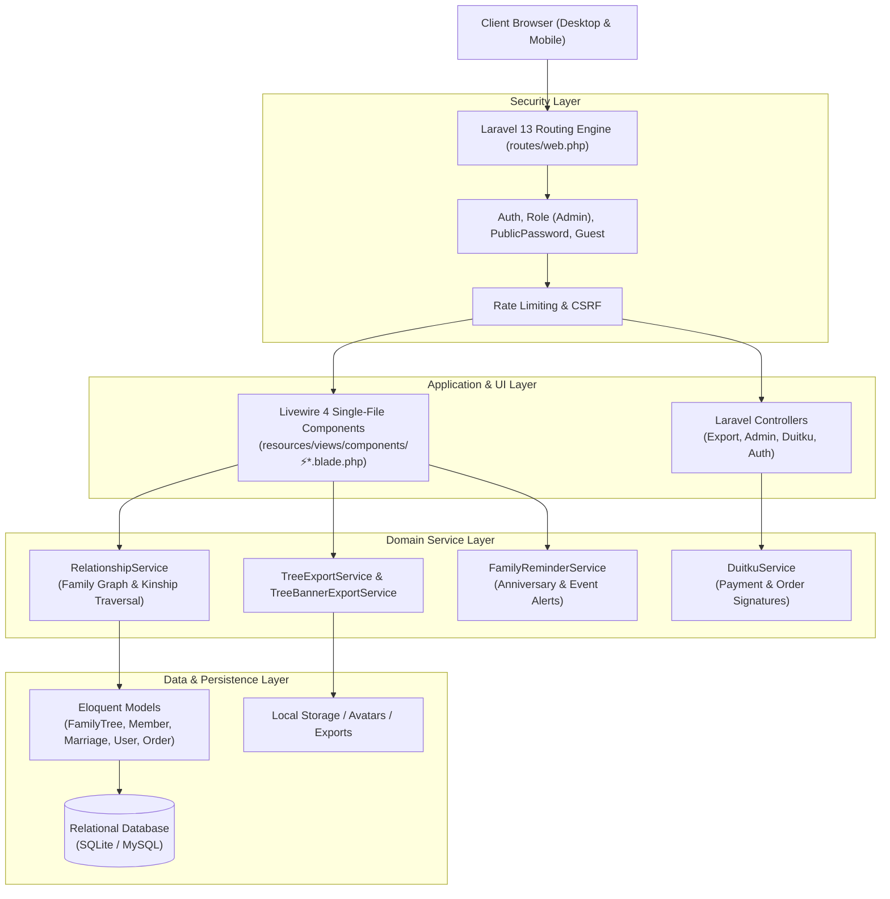

# Phase 1 — Deep Application Discovery Report

**Tanggal Audit:** 31 Oktober 2026  
**Aplikasi:** Silsilah (Family Tree Platform)  
**Status Baseline:** Sehat (287 Passed, 2 Skipped, 1157 Assertions, Duration ~16s)

---

## 1. Technology Stack Inventory

| Komponen | Teknologi | Versi | Status / Catatan |
|---|---|---|---|
| **Runtime Language** | PHP (CLI) | 8.4.19 | OPcache v8.4.19 aktif, Laravel Herd build |
| **Backend Framework** | Laravel Framework | 13.2.0 | Versi LTS/Latest modern Laravel |
| **Frontend Engine** | Livewire | 4.2.3 | Menggunakan Single-File Components (`⚡*.blade.php`) |
| **Component Library** | Flux UI (Livewire) | 2.13.2 | Tailwind-based native components |
| **CSS Framework** | Tailwind CSS | 4.2.2 | Menggunakan `@tailwindcss/vite` |
| **Bundler & Build Tool** | Vite | 8.0.3 | Node environment, lightningcss |
| **Database Engine** | SQLite (dev/test) / MySQL compatible | Default | Driver SQLite dengan schema migrations |
| **Testing Harness** | Pest PHP | 4.4.3 | Pest Laravel Plugin v4.1.0 |
| **Authentication** | Laravel Fortify & Socialite | Fortify 1.36.2 / Socialite 5.28 | Email/password, 2FA TOTP, Google SSO |
| **Payment Gateway** | Duitku Integration | Custom Service | Callback signature validation & checkout |
| **Export Engines** | Spatie Browsershot & Puppeteer | 5.2.3 / 24.40.0 | Headless Chrome render, PDF/PNG banner/book export |
| **Image Processing** | Intervention Image | 4.0.0 | Crop, resize, local avatar storage |

---

## 2. Application Architecture Topology

---

## 3. Module Inventory

### A. Core Family Tree & Visualizations
- **Vertical Tree View (`tree/{tree}/vertical`):** Tampilan pohon vertikal dari atas ke bawah (leluhur ke keturunan) dengan kartu anggota, foto, dan tombol aksi cepat.
- **Simple / Pedigree View (`tree/{tree}/simple`):** Tampilan bagan silsilah ringkas yang berfokus pada garis keturunan langsung.
- **Dock Variant (`tree/{tree}/dock`):** Desain mobile-first dengan bilah navigasi bawah (*bottom dock*), optimal untuk akses smartphone di acara keluarga.
- **Public & Shared Access (`public/tree/{slug}`):** Halaman pohon silsilah publik yang dapat dilindungi dengan kata sandi (*password gate*).

### B. Member & Relationship Management
- **Member Manager Modal (`⚡member-manager.blade.php`):** Komponen sentral untuk menambah, mengedit, dan menghapus anggota keluarga, mengunggah foto, serta mengatur tanggal lahir/wafat.
- **Relationship Calculator (`⚡relationship-calculator.blade.php`):** Fitur interaktif untuk menghitung sebutan hubungan kekerabatan antara dua anggota keluarga (misal: paman, keponakan, sepupu dua kali).
- **Cross-Tree Cloning (`tests/Feature/CrossTreeCloningTest.php`):** Sinkronisasi dan kloning cabang keluarga antar pohon yang berbeda.

### C. Family Events, Reminders & Telegram Integration
- **Family Events & Reminders (`⚡family-reminders.blade.php`):** Kalender peristiwa penting keluarga (ulang tahun, hari pernikahan, haul/peringatan wafat).
- **iCalendar Sync (`tree/{tree}/calendar.ics`):** Ekspor kalender keluarga ke Google Calendar / Apple Calendar.
- **Telegram Notification Service:** Pengiriman pengingat berkala ke grup Telegram keluarga.

### D. SaaS Monetization & Quota
- **Pricing Packages & Orders (`admin/pricing`, `orders/checkout`):** Sistem kuota pembuatan pohon berbayar.
- **Duitku Gateway Integration:** Pemrosesan transaksi otomatis via Virtual Account dan QRIS.
- **Voucher & Referral System:** Kode diskon dan insentif referral antarpengguna.

### E. Superadmin Operations Hub
- **Admin Dashboard & Impersonation (`admin/dashboard`, `admin/impersonate`):** Pengawasan pohon pengguna, kuota, audit log, serta backup database otomatis.

---

## 4. Baseline Health & Test Suite Summary

- **Total Test Cases:** 289
- **Passing:** 287 tests (100% dari tes aktif)
- **Skipped:** 2 tests (terkait konfigurasi environment opsional)
- **Assertions:** 1,157 assertions
- **Execution Time:** ~16.0 detik
- **Code Style (Laravel Pint):** Mengikuti aturan standar Laravel Pint dengan flag `--dirty --format agent`.

---

## 5. Ringkasan Temuan Phase 1

1. Arsitektur silsilah menggunakan pendekatan **Single-File Component (SFC)** Livewire 4, di mana logika PHP dan Blade berada dalam satu berkas `⚡*.blade.php`. Pendekatan ini sangat responsif dan memangkas boilerplate, namun beberapa file berpotensi tumbuh menjadi terlalu besar (>500 baris).
2. Domain logic keluarga telah dipisahkan ke Service Layer (`RelationshipService`, `FamilyReminderService`, `TreeExportService`), menjaga agar controller tetap ramping (*skinny controllers*).
3. Fondasi pengujian sudah sangat baik dengan 287 feature/unit test, memberikan *safety net* yang kuat untuk tahap audit mendalam berikutnya.
