# Phase 3 — Product & User Experience Audit Report

**Halaman & Komponen Diperiksa:** Landing Page (`welcome.blade.php`), Dashboard, Visualisasi Pohon (`tree-vertical`, `tree-view`, `tree/dock`), Onboarding Tour (`onboarding-tour.blade.php`)  
**Fokus Evaluasi:** Alur Pengguna (User Journey), Ergonomi Mobile, Hirarki Visual, & Visualisasi Silsilah

---

## 1. Pemetaan Alur Pengguna (User Journey Mapping)

```mermaid
flowchart LR
    Landing["Landing Page\n(welcome.blade.php)"] --> Register["Google SSO / Fortify Auth"]
    Register --> Dashboard["Dashboard Silsilah\n(Daftar Pohon & Kuota)"]
    Dashboard --> CreateTree["Modal Buat Pohon\n(Nama & Deskripsi)"]
    CreateTree --> TreeExplorer["Pohon Silsilah Explorer\n(Onboarding Quest Tour)"]
    TreeExplorer --> AddRoot["Tambah Anggota Inti / Leluhur\n(Modal Form)"]
    AddRoot --> AddFamily["Tambah Pasangan & Anak\n(Multi-generation)"]
    AddFamily --> Share["Bagikan Link / Export Banner / PDF"]
```

### Friction Points (Hambatan Alur):
1. **Modal Form Terlalu Padat:**
   Modal `⚡member-manager` memuat puluhan input sekaligus (nama depan, nama belakang, gender, tanggal lahir, tempat lahir, tanggal wafat, tempat wafat, tanggal nikah, status perkawinan, foto/avatar, nomor telepon, alamat, profesi, bio). Pengguna pemula yang hanya ingin mencatat nama kakek/nenek merasa terbebani (*form fatigue*).
   - **Rekomendasi:** Terapkan *Progressive Disclosure*: Tahap awal hanya meminta (Nama Lengkap, Gender, Status Hidup/Wafat). Tombol *"Detail Tambahan & Arsip"* dapat dibuka jika pengguna ingin melengkapi data.
2. **Onboarding Tour Game-Like:**
   Onboarding tour (`onboarding-tour.blade.php`) dengan quest system (buat pohon -> tambah anggota pertama -> hubungkan pasangan) sangat interaktif, tetapi pada layar mobile kecil (iPhone SE / Android 360px), banner quest terkadang menutupi node pohon di belakangnya.
   - **Rekomendasi:** Tambahkan mode collapse/minimize untuk quest bar mobile menjadi pill kecil di sudut atas.

---

## 2. Evaluasi Visualisasi Pohon Silsilah

### A. Tampilan Vertikal Generasi (Vertical Focus View)
- **Kelebihan:** Sangat intuitif untuk navigasi ponsel. Menempatkan anggota fokus di tengah, orang tua di atas, pasangan di samping, dan anak-anak di bawah.
- **Kelemahan:** Pengguna kehilangan konteks gambaran besar (*big picture bird's-eye view*) dari keluarga besar saat silsilah memiliki 5 generasi atau lebih.
- **Rekomendasi:** Tambahkan *Mini-Map* atau *Breadcrumb Traversal* di bagian atas (misal: `Kakek Buyut > Kakek > Ayah > Anda`) agar pengguna tahu posisi generasinya saat ini.

### B. Tampilan Horizontal (Classic Family Tree)
- **Kelebihan:** Memberikan visualisasi pohon silsilah klasik seperti diagram bagan keluarga konvensional.
- **Kelemahan:** Pada layar smartphone, garis konektor CSS membuat pohon melebar ribuan piksel ke kanan, mengharuskan scroll horizontal bolak-balik yang melelahkan.
- **Rekomendasi:** Pengalihan otomatis (*device auto-redirect*) yang sudah diterapkan ke tampilan vertikal untuk layar mobile sudah sangat tepat, namun pada desktop perlu ditambahkan kontrol *Zoom In / Zoom Out / Reset View* (pan-zoom viewport).

### C. Bottom Dock Navigation (`tree/dock.blade.php`)
- **Evaluasi:** Sangat ergonomis untuk pengoperasian dengan satu tangan (*one-thumb ergonomics*). Akses ke tombol "Tambah Anggota", "Kalkulator Nasab", "Kalender Haul", dan "Cari Anggota" langsung berada dalam jangkauan jempol di bagian bawah layar.
- **Rekomendasi:** Pertahankan pola ini sebagai default interface saat aplikasi dibuka di perangkat mobile.

---

## 3. Identitas Visual & Karakter Desain (Heritage Aesthetics)

- **Karakter Saat Ini:** Dominan hijau zamrud (*Emerald* `#059669`) dengan aksen abu-abu netral. Tampilan terasa bersih dan rapi seperti aplikasi SaaS produktivitas modern.
- **Peluang Transformasi "Digital Family Heritage":**
  Aplikasi silsilah keluarga memiliki muatan emosional, sejarah, dan nilai kenangan yang tinggi.
  - Tambahkan sentuhan hangat (*warm earth tones*): Warm stone, subtle amber gold borders, dan background bernuansa perkamen halus (*subtle textured parchment/warm cream*).
  - Tipografi: Padukan font Sans-serif modern untuk antarmuka dengan font Serif elegan (*Playfair Display* atau *Lora*) untuk judul pohon keluarga dan ekspor dokumen silsilah.
  - Kartu Anggota: Tambahkan badge visual yang anggun untuk membedakan generasi (Generasi 1, Generasi 2) serta indikator status haul/ulang tahun yang tidak mencolok namun informatif.
